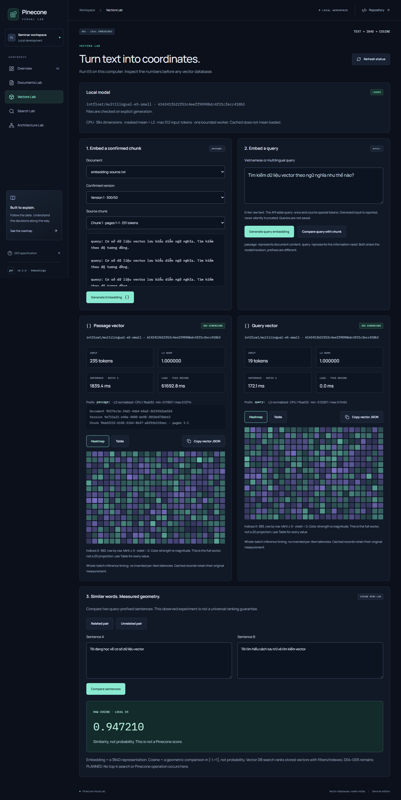

# Pinecone Visual Lab

A local vector-database seminar workbench. **D03 implements local E5 embeddings and a 384D inspector/cosine mini-lab**, preserving D02 PDF/TXT documents, chunks, confirmed versions and JSONL. Pinecone operations, top-k retrieval, RAG and Slab remain **PLANNED (D04–D09)**. This project is independent of Pinecone's console.



## Windows setup

Tested: PowerShell 5.1, Git for Windows, Node **22.20.0** / npm **10.9.3**, Python **3.13.7**, installed Microsoft Edge. Node minimum 22.13. Use this existing checkout; create the virtual environment only if absent.

```powershell
Set-Location -LiteralPath 'D:\Corel\HK1_NAM4\PR\Giữa kì\pinecone-visual-lab'
npm.cmd ci
python -m venv .venv
.\.venv\Scripts\python.exe -m pip install -r 'apps\api\requirements.lock'
```

For real chunking, explicitly opt in to **one tokenizer JSON: 17,082,730 bytes (about 17.1 MB)**:

```powershell
.\.venv\Scripts\python.exe scripts/setup_tokenizer.py --accept-download
```

The allowlisted, SHA-256 verified asset is pinned to revision `614241f622f53c4eeff9890bdc4f31cfecc418b3` of `intfloat/multilingual-e5-small`, cached under ignored `.cache/tokenizer/`. **No embedding weights** are downloaded. Without assets, upload/extraction work but chunking is disabled with instructions. Startup and requests never download or silently substitute a tokenizer. [Budget, revision and licenses](docs/tokenizer.md).

Start API in one PowerShell terminal at the root:

```powershell
.\.venv\Scripts\python.exe -m uvicorn app.main:app --app-dir apps/api --host 127.0.0.1 --port 8000
```

Start web in another terminal:

```powershell
npm.cmd run dev:web
```

Open **http://127.0.0.1:5173/documents**. Health: **http://127.0.0.1:8000/api/health**; schema: http://127.0.0.1:8000/docs. Stop owned processes with Ctrl+C; no services are installed. Health refreshes every 15 seconds/on demand with a 5-second timeout. Stop API and click **Check connection** to see OFFLINE. Pinecone stays NOT CONFIGURED. Embedding status reports actual cache/load state; the model loads only on explicit generation.

## Local E5 / Vectors Lab (D03)

Before the first large download, approve the official source/size/resource disclosure. The current D03 owner approved it on 2026-11-11. Then explicitly run:

```powershell
.\.venv\Scripts\python.exe scripts/setup_embedding_model.py --accept-download
```

Source: official HF snapshot `614241f622f53c4eeff9890bdc4f31cfecc418b3`, matching D02 tokenizer. Safetensors **470,641,600 bytes (~471 MB)**, SHA-256 `1a55775f53449dac10a2bcbc312469fac40b96d53198c407081a831f81c98477`. Reserve3GB disk and3–4GB available RAM; runtime dependencies are in the lock. Ignored `.cache/embedding-model/`; optional `PVL_MODEL_DIR`. No startup/API/CI downloads. See [model architecture/licenses/resources](docs/architecture/embeddings.md).

Open **http://127.0.0.1:5173/vectors**. Choose document → confirmed version → chunk → Generate Embedding. The first call verifies/loads local weights in one CPU worker; status distinguishes cached/not loaded/loading/loaded/unavailable. Inspect all384 values as heatmap/table, norm/tokens/pages/revision and measured whole-batch latency; Copy includes full JSON. Enter raw Vietnamese query (prefix added once), generate it, then compare with the chunk. Two-sentence presets demonstrate raw cosine, not probability or Pinecone score. No Vector DB search occurs.

Batches1–8, total≤512 input tokens including prefix/specials, no truncation; oversized input fails. Timeout120s, frontend cancellation130s, explicit Cancel stops owned inference worker. Only confirmed chunk vectors persist idempotently in SQLite schema2; ad hoc queries never persist. Earlier confirmed versions/D02 drafts remain intact. [D03 evidence](docs/evidence/d03/REPORT.md).

## Documents Lab

1. Choose/drop PDF or UTF-8 TXT (BOM supported). Default cap **10 MiB**, maximum **200 PDF pages / 500,000 extracted characters**. Unsupported, binary, corrupt, encrypted, empty and oversized inputs receive errors. Image-only/blank pages show **OCR NOT AVAILABLE**; no OCR runs.
2. Inspect 1-based pages, character counts and raw extracted text. TXT is one logical page. Canonical text uses NFC, CRLF/CR to LF, no whitespace trim/collapse, two LF between pages.
3. Generate preview with default **300/50**. Size 1–507, overlap 0 ≤ overlap < size. Full `passage: ` + text + special tokens is independently checked against **512 tokens**. Very small sizes may not fit a Unicode token group; increase size when prompted.
4. Inspect chunks, real content/input tokens and page ranges. Highlighted overlap uses the full source token stream; Unicode-safe cuts can reduce requested overlap, which is explicitly reported.
5. **Confirm / Save** before download. Each preview persists a separate draft/version. Input changes preserve displayed/confirmed results. Reload selects confirmed or newest draft if none confirmed. Earlier versions remain selectable. Copy text or download one UTF-8 JSON object per chunk. Deletion requires explicit confirmation and removes the file/pages/versions.

Original UUID-named files and SQLite stay in ignored **`.data/`**. Back up local data yourself before upgrades. The [JSONL sample](docs/evidence/d02/synthetic-confirmed.jsonl) contains only synthetic E2E data. [Schema, provenance and limits](docs/architecture/documents.md).

## Configuration

`.env.example` lists placeholders. No credentials are needed. Backend reads **process environment**, not `.env` automatically: e.g. `$env:PVL_MAX_UPLOAD_BYTES='10485760'` (allowed 1 byte–50 MiB). `PVL_DATA_DIR` changes the storage root; keep custom locations out of Git. `PVL_TOKENIZER_DIR` may point to the exact verified `tokenizer.json` directory; leave unset for default cache.

Vite proxies `/api` to port 8000; `PVL_API_PROXY_TARGET` changes that dev proxy. For separate hosting, optional `VITE_API_BASE_URL` goes in `apps/web/.env.local`. Set explicit `PVL_CORS_ORIGINS` in the backend terminal if needed; wildcard origins are rejected. Never put secrets in `VITE_*`. Production output is `apps/web/dist/`; `npm.cmd run preview --workspace apps/web` serves port4173 with API still required. This is a local preview.

## Checks and browser tests

```powershell
powershell -NoProfile -ExecutionPolicy RemoteSigned -File scripts/check.ps1
.\.venv\Scripts\python.exe scripts/run_pytest.py -m "real_tokenizer or real_model" -v -s
npm.cmd run test:e2e
npm.cmd audit --audit-level=moderate
```

`RemoteSigned` applies only to that PowerShell process, preserving persistent policy/hooks. `check.ps1` fails on any required ESLint, strict typecheck, Vitest, Ruff, Pytest/API/Git guards, build, artifact/secret scan or whitespace check failure. Separate real-tokenizer/model tests require explicitly installed cached assets (otherwise SKIPPED); no download occurs. Default tests exclude both markers. The Pytest helper creates fresh ignored temp/cache directories, avoiding shared Windows Temp ACL problems without changing user Temp.

Playwright uses installed **Edge**, starts isolated web/API on **5174/8001**, stores synthetic data under ignored `.cache/e2e-d03/` and stops its owned servers. Occupied ports cause failure instead of server reuse. Local default E2E uses actual E5 tokenizer and weights; ensure model setup before running. It additionally checks confirmed source → 384 values/table/copy → query → cosine and model-unavailable behavior. Fixtures use installed Windows Arial for Vietnamese PDFs (font not redistributed). Tests cover upload → pages → generate → inspect/overlap/copy → confirm → export → reload, draft recovery, delete confirmation, axe serious/critical checks, navigation, reduced motion, responsive widths and injected network failure/recovery. Actual screenshots go to `docs/evidence/d03/`; historical D01/D02 evidence is unchanged.

Reproduce CI's **explicit fixture mode**, which requires no AI assets:

```powershell
$env:HF_HUB_OFFLINE='1'
$env:TRANSFORMERS_OFFLINE='1'
$env:PVL_E2E_FIXTURE='1'
npm.cmd run test:e2e
Remove-Item Env:PVL_E2E_FIXTURE
```

The separate **test-only** server declares `test-fixture-not-e5` in API/UI/JSONL. These counts are never claimed as E5. Fixture screenshots go to `test-results/fixture-screenshots/`. Normal `app.main:app` never selects this fixture based on that variable. Package/browser installation uses network; runtime CI tests require no HF/cloud resources and never call tokenizer setup. GitHub CI status remains PENDING until a real run.

Individual commands: `npm.cmd run lint`, `npm.cmd run typecheck`, `npm.cmd test`, `.\.venv\Scripts\python.exe -m ruff check apps/api scripts tests`, `.\.venv\Scripts\python.exe -m pytest -c apps/api/pyproject.toml`, `npm.cmd run build`, `.\.venv\Scripts\python.exe scripts/verify_repository.py`.

## Git workflow

Read [authentic workflow](GITHUB_COLLAB_WORKFLOW_STANDARD.md), [branch policy](docs/BRANCH_POLICY.md), [AGENTS.md](AGENTS.md). Original workflow SHA-256: `5CB214CB8CF499A83A480F1B244DA5C274DD66C8FCC211DB83ED246C82E20E78`. Original workflow/master-plan whitespace is preserved by `.gitattributes` exceptions.

Active: **[Issue #5](https://github.com/iamqthanq/pinecone-visual-lab/issues/5)**, **`feature/issue-5-local-embeddings`**, base **`main`** after D02 PR #4 merge. Configure checkout guards per policy. After review/tests/commit:

```powershell
powershell -NoProfile -ExecutionPolicy RemoteSigned -File scripts/push_issue_branch.ps1
```

The no-argument script validates checkout/active Issue/branch/remote/HEAD and pushes one matching explicit refspec. Tests use disposable Git fixtures, never rejected pushes to GitHub. Agent implements/tests/pushes; ChatGPT opens Draft PR and independently reviews; user decides merge. No main push, force, bypass, automatic Issue closing or next-phase work.

## Architecture and evidence

Current: [D03 report/logs](docs/evidence/d03/REPORT.md), [embedding design/schema2](docs/architecture/embeddings.md), [desktop1440](docs/evidence/d03/vectors-desktop-1440.png), [mobile390](docs/evidence/d03/vectors-mobile-390.png). D01/D02 evidence links below are historical.

- [Current architecture/health](docs/architecture/overview.md), [D02 schema/provenance](docs/architecture/documents.md), [tokenizer/licenses](docs/tokenizer.md)
- [Free-first ADR](docs/decisions/0001-free-first-stack.md), [Taste source/design](docs/design-foundation.md)
- [D02 requirement/test report](docs/evidence/d02/REPORT.md), [desktop](docs/evidence/d02/desktop-1440.png), [mobile](docs/evidence/d02/mobile-390.png)
- [Historical D01 report](docs/evidence/d01/REPORT.md)

Future LIVE PINECONE, LOCAL DEMO retrieval and SLAB SIMULATOR remain planned. D03 ships real local embeddings; no upserts, top-k search, OCR or production hosting. PDF reading order follows the text layer and may differ from visual layout. API is for loopback/local use without multi-user authentication. Resource caps do not constitute a hostile-PDF execution sandbox. Repository scan is focused, not a comprehensive security audit.
