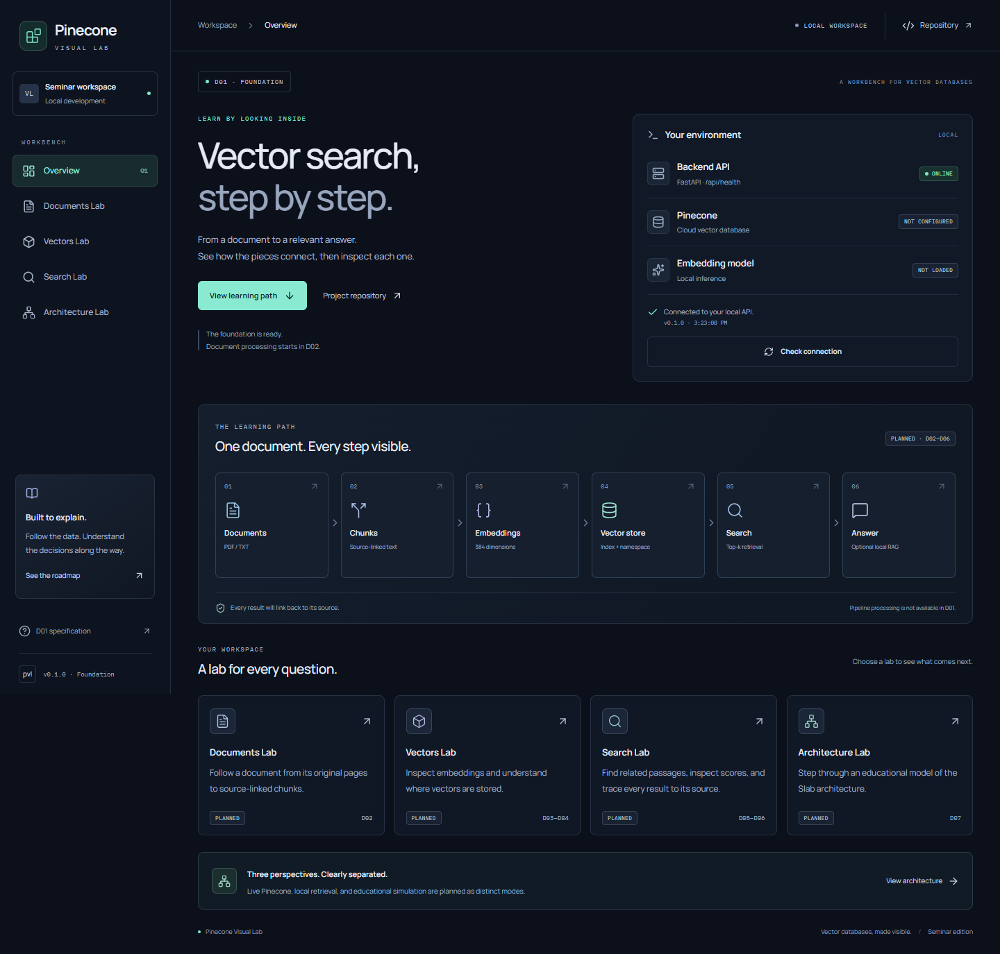

# Pinecone Visual Lab

A local workbench for a vector database seminar. **D01 is implemented:** React navigation and design foundation, a real FastAPI health endpoint, Git safeguards, automated checks, and PR CI configuration.

PDF upload, chunking, embedding, Pinecone retrieval, RAG, the Slab simulator, and Guided Demo are **PLANNED (D02–D09)**. The roadmap cards navigate to explanatory pages; they do not process data. This project is independent of Pinecone's console.



## Windows setup

Tested with Windows PowerShell 5.1, Git for Windows, Node **22.20.0** / npm **10.9.3**, and Python **3.13.7**. Node must be at least 22.13. Use this existing checkout; do not clone into it again.

```powershell
Set-Location -LiteralPath 'D:\Corel\HK1_NAM4\PR\Giữa kì\pinecone-visual-lab'
npm.cmd ci
python -m venv .venv
.\.venv\Scripts\python.exe -m pip install -r 'apps\api\requirements.lock'
```

Start API in one PowerShell terminal:

```powershell
.\.venv\Scripts\python.exe -m uvicorn app.main:app --app-dir apps/api --host 127.0.0.1 --port 8000
```

Start web in another terminal at the same repository root:

```powershell
npm.cmd run dev:web
```

Open **http://127.0.0.1:5173/**. API health: **http://127.0.0.1:8000/api/health**; API schema: http://127.0.0.1:8000/docs. Stop owned dev processes with Ctrl+C; no startup tasks or services are installed. The UI requests health on load, every 15 seconds, and on **Check connection**; requests time out after 5 seconds. Stop the API and check again to see the real offline state.

The dev server proxies `/api` to port 8000. To use a separate API address, copy the optional `VITE_API_BASE_URL` setting from `.env.example` to `apps/web/.env.local` and restart Vite. No `.env` file is required for D01. For backend configuration set `$env:PVL_CORS_ORIGINS` in its terminal; the API reads process environment, not `.env` files automatically. Allowed local origins are explicit; wildcard configuration is rejected. Never put secrets in `VITE_*` variables. Pinecone credentials are not used in D01.

## Checks and browser tests

```powershell
powershell -NoProfile -ExecutionPolicy RemoteSigned -File scripts/check.ps1
npm.cmd run test:e2e
```

`RemoteSigned` applies only to that PowerShell process and permits these local scripts on machines whose default execution policy blocks scripts. It does not disable Git hooks or change persistent Windows policy. Managed policies still take precedence.

`check.ps1` fails immediately on a nonzero required command: ESLint, TypeScript strict, Vitest, Ruff, Pytest API/Git guards, production build, repository scan, and diff whitespace. Browser tests auto-start web/API if absent and stop the processes they start. On Windows they use installed **Microsoft Edge**; if missing, install Edge through its official channel before running. Tests include live health, navigation/deep links, 320/390/768/1024/1440 overflow checks, reduced motion, keyboard skip link, axe serious/critical checks, and explicitly intercepted network-failure/recovery. Tests do not download AI models or use cloud credentials.

Individual commands:

```powershell
npm.cmd run lint
npm.cmd run typecheck
npm.cmd test
.\.venv\Scripts\python.exe -m ruff check apps/api scripts tests
.\.venv\Scripts\python.exe -m pytest -c apps/api/pyproject.toml
npm.cmd run build
.\.venv\Scripts\python.exe scripts/verify_repository.py
```

Production web output is `apps/web/dist/`. `npm.cmd run preview --workspace apps/web` serves it on port 4173; the backend must still run. This is a local preview, not a production deployment.

For an additional real-offline check, stop only this project's API, leave the web server running, and run `node scripts/browser_offline_smoke.mjs`. It verifies the API is unreachable and captures the actual offline UI without intercepting requests. Restart the API afterwards.

## Git workflow

Read [the authentic shared workflow](GITHUB_COLLAB_WORKFLOW_STANDARD.md), [project branch policy](docs/BRANCH_POLICY.md), and [AGENTS.md](AGENTS.md). The supplied workflow is preserved byte-for-byte. Its SHA-256 is `5CB214CB8CF499A83A480F1B244DA5C274DD66C8FCC211DB83ED246C82E20E78`. The supplied workflow and reference master plan retain their original Markdown trailing whitespace/blank EOF via explicit `.gitattributes` exceptions.

Assignment: [Issue #1](https://github.com/iamqthanq/pinecone-visual-lab/issues/1), branch `feature/issue-1-foundation`, integration `main`. Configure local guards as documented in the branch policy; configuration is per checkout and is not installed by npm. After reviewing/tests/staging/commit, push from the repo root:

```powershell
powershell -NoProfile -ExecutionPolicy RemoteSigned -File scripts/push_issue_branch.ps1
```

The script takes no arguments, validates active Issue/branch/checkout/remote, and emits one matching explicit refspec. Hook tests run in disposable Git fixtures, not against the real remote. Agent implements/tests/pushes; ChatGPT opens one Draft PR and reviews independently; user alone decides merge. No direct push to main, force push, hook bypass, or automatic Issue closing.

## Architecture, design, and evidence

- [Architecture and health contract](docs/architecture/overview.md)
- [ADR: free-first stack](docs/decisions/0001-free-first-stack.md)
- [Design brief and Taste source review](docs/design-foundation.md)
- [D01 evidence and requirement mapping](docs/evidence/d01/REPORT.md)
- [Desktop screenshot](docs/evidence/d01/desktop-1440.png) / [mobile screenshot](docs/evidence/d01/mobile-390.png)

Future **LIVE PINECONE** uses the real cloud API; **LOCAL DEMO** uses local retrieval, with fixtures labeled; **SLAB SIMULATOR** is educational simulation, not live telemetry. None of these processing modes is operational in D01.

CI runs on PRs to `main` or manual dispatch using a Windows GitHub runner, locked npm/Python dependencies, local checks, and browser/API smoke. A workflow file is not evidence of a successful GitHub run: see the handoff report for actual status. The repository scan is a small pattern/artifact check, not an exhaustive security audit. Deployment, document ingestion, and model availability remain outside D01.
